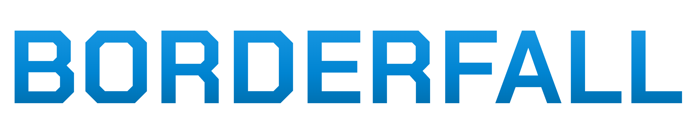

<p align="center">
  
</p>

Borderfall is an online real-time strategy game about territorial control, trade and alliances. It
is a fork of [OpenFront](https://github.com/openfrontio/OpenFrontIO) (itself a fork/rewrite of
[WarFront.io](https://github.com/WarFrontIO)) and is not affiliated with or endorsed by OpenFront.


[](https://www.gnu.org/licenses/agpl-3.0)
[](https://creativecommons.org/licenses/by-sa/4.0/)

## What Borderfall adds

Planned on top of OpenFront's game (see `legacy/README.md` for the full design notes):

- **Regional goods.** Food (fertile plains, rivers), Oil (deserts, offshore) and Metal (mountains,
  hills). No region has all three, so nations have to trade. Food is a soft rule (a shortage slows
  troop growth). Oil and Metal are hard rules: **Oil moves** (warships, missiles), **Metal stands**
  (defense posts, SAMs, silos, city upgrades).
- **Trading and diplomacy.** Player trade offers (any mix of gold, troops, goods, tiles or a
  ceasefire, with counter-offers), trade pacts that boost goods income, and embargoes.
- **Smarter AI.** Difficulty changes how well bots and nations decide, never how many troops they
  get.
- **Pacing.** Games are tuned to finish in under 40 minutes.

## Standalone

OpenFront's closed-source API (accounts, store, cosmetics, ranked matchmaking, news, ads, the
multi-server registry) is not part of Borderfall. The client runs in standalone mode
(`src/client/Standalone.ts`): those menus, promos and third-party scripts are gone, and the game
server schedules its own public lobbies. Solo, public lobbies, private lobbies and join-by-code all
work with just `npm run dev`.

Game server switches: `MASTER_PORT` (default 3000) moves the master's port; `TRUSTED_LOBBIES=true`
re-enables OpenFront's trusted-only lobby rotation (which needs the API to vouch for accounts).

## Syncing with OpenFront

The OpenFront repository is configured as the `upstream` remote, so its fixes and features can be
merged in:

```bash
git fetch --no-tags upstream main
git merge upstream/main
```

The original Borderfall prototype lives in `legacy/` and is tagged `borderfall-m0`.

## License

Borderfall, like OpenFront, is licensed under the **GNU Affero General Public License v3.0**. The
source code for the running game is available at https://github.com/kfidak13/TerritoryGame.

OpenFront's AGPL additional terms require keeping its copyright notice visible. It currently appears
in:

- Footer: "© OpenFront and Contributors"
- Loading screen: "© OpenFront and Contributors"

Modified versions must preserve these notices in reasonably visible locations.

See the [LICENSE](LICENSE) for complete requirements.

For asset licensing, see [LICENSE-ASSETS](LICENSE-ASSETS).  
For license history, see [LICENSING.md](LICENSING.md).

OpenFront's proprietary assets (logo, font, music; its `proprietary/` folder) are not licensed for
other projects and have been removed. Borderfall uses its own logo and the
[Chakra Petch](https://fonts.google.com/specimen/Chakra+Petch) font (SIL Open Font License, see
`resources/fonts/ChakraPetch-OFL.txt`). Menu music, gameplay music and the game-start alert are not
yet replaced, so those sounds are currently silent.

## 🌟 Features

- **Real-time Strategy Gameplay**: Expand your territory and engage in strategic battles
- **Alliance System**: Form alliances with other players for mutual defense
- **Multiple Maps**: Play across various geographical regions including Europe, Asia, Africa, and more
- **Resource Management**: Balance your expansion with defensive capabilities
- **Cross-platform**: Play in any modern web browser

## 📋 Prerequisites

- [Node.js](https://nodejs.org/) v24.15.0 or newer in the Node 24 release line
- [npm](https://www.npmjs.com/) v12.1.0 or newer in the npm 12 release line
- A modern web browser (Chrome, Firefox, Edge, etc.)

Node.js may bundle an older npm version. Upgrade it before installing project dependencies:

```bash
npm install --global --ignore-scripts npm@12.1.0
```

## 🚀 Installation

1. **Clone the repository**

   ```bash
   git clone https://github.com/kfidak13/TerritoryGame.git
   cd TerritoryGame
   ```

2. **Install dependencies**

   ```bash
   npm run inst
   ```

   Do NOT use `npm install` nor `npm i` for project dependencies. Use `npm run inst`; it runs the safer `npm ci --ignore-scripts` to install exactly the versions in `package-lock.json` without running lifecycle scripts.

   The repository also rejects dependency releases less than seven days old and dependencies sourced from Git, remote URLs, local tarballs, or directories. Wait until a new release passes the seven-day window before updating it; security exceptions require explicit maintainer review.

## 🎮 Running the Game

### Development Mode

Run both the client and server in development mode with live reloading:

```bash
npm run dev
```

This will:

- Start the webpack dev server for the client
- Launch the game server with development settings
- Open the game in your default browser (to disable this behavior, set `SKIP_BROWSER_OPEN=true` in your environment)

### Play with friends

Borderfall needs no hosting service to play with friends: your computer runs the game server, and
the simulation runs in each player's browser.

**Same Wi-Fi / home network**

1. Start the game reachable from your network:

   ```bash
   npm run dev:host
   ```

   (If port 3000 is taken on your machine, prefix it with `MASTER_PORT=3100`.) The output prints a
   `Network:` address such as `http://192.168.1.20:9000`.

2. Open **that Network address yourself** (not `localhost`), click **Create Lobby**, and copy the
   lobby link: it then points at your machine, so friends can open it.
3. Friends open the link on their own devices, and you press **Start Game**.

Each player needs their own device or browser profile: two tabs in one browser count as the same
player.

**Friends somewhere else** (untested): a free [Cloudflare quick
tunnel](https://developers.cloudflare.com/cloudflare-one/connections/connect-networks/do-more-with-tunnels/trycloudflare/)
gives your machine a temporary public address without an account. With `npm run dev:host` running,
run `cloudflared tunnel --url http://localhost:9000`, open the printed `https://….trycloudflare.com`
address yourself, create the lobby there, and share its link. `dev:host` accepts those hostnames.

### Client Only

To run just the client with hot reloading:

```bash
npm run start:client
```

### Server Only

To run just the server with development settings:

```bash
npm run start:server-dev
```

## 🛠️ Development Tools

- **Format code**:

  ```bash
  npm run format
  ```

- **Lint code with Oxlint and ESLint**:

  ```bash
  npm run lint
  ```

- **Lint and fix code with Oxlint and ESLint**:

  ```bash
  npm run lint:fix
  ```

- **Testing**
  ```bash
  npm test
  ```

## 🏗️ Project Structure

- `/src/client` - Frontend game client
- `/src/server` - Backend game server
- `/packages/engine` - Deterministic game simulation (`@openfront/engine`)
- `/packages/engine-api` - The engine's contract: types, schemas, game updates and the worker protocol (`@openfront/engine-api`)
- `/packages/engine-lib` - Engine code also used outside the engine: map grid, rules, helpers (`@openfront/engine-lib`)
- `/packages/shared` - Code shared by client and server: wire schemas, env, asset URLs (`@openfront/shared`)
- `/packages/zbin` - Compact binary wire format for zod schemas (self-contained, zod-only)
- `/resources` - Static assets (images, maps, etc.)

## 🤝 Contributing

Contributions and translations are welcome! See [CONTRIBUTING.md](CONTRIBUTING.md) for the workflow, the approved-issue process, project governance, and translation info.
